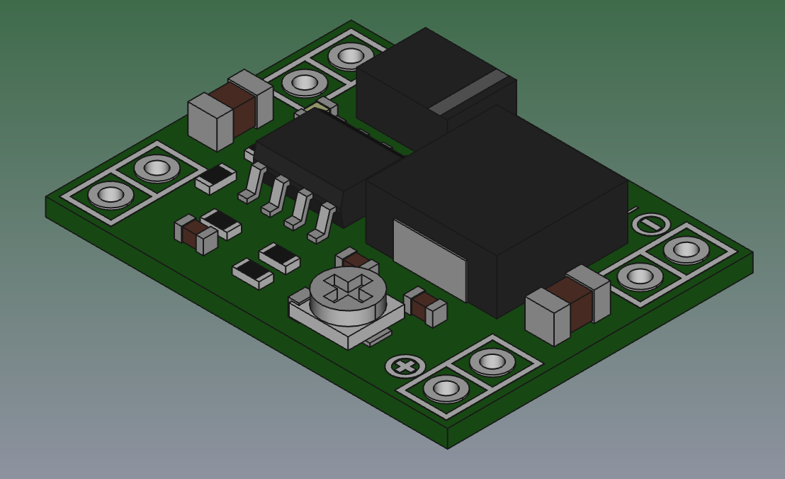

# D-SUN DC-DC Step-Down Voltage Regulator KiCad Library

## Overview
- **Module**: D-SUN Mini DC-DC Step-Down (Buck) Voltage Regulator Module (MP1584EN / MP2307)
- **Input Voltage**: 4.5V - 28V DC
- **Output Voltage**: 0.8V - 20V DC (Adjustable via onboard potentiometer)
- **Output Current**: Up to 3A max (2A continuous recommended)
- **Dimensions**: 22.1mm x 16.8mm
- **Pin Pitch**: 2.54mm (0.1") dual-pin holes + castellated SMD pads per corner

## Pinout
- **Pin 1 (IN+)**: Input DC Positive Voltage
- **Pin 2 (IN-)**: Input DC Ground / Negative
- **Pin 3 (OUT+)**: Output DC Positive Voltage (Regulated, e.g. 5V)
- **Pin 4 (OUT-)**: Output DC Ground / Negative (Common Ground)

## 3D Model
- Source: [GrabCAD - D-SUN DC-DC Step Down Voltage Regulator Simple Version](https://grabcad.com/library/d-sun-dc-dc-step-down-voltage-regulator-simple-version-1)
